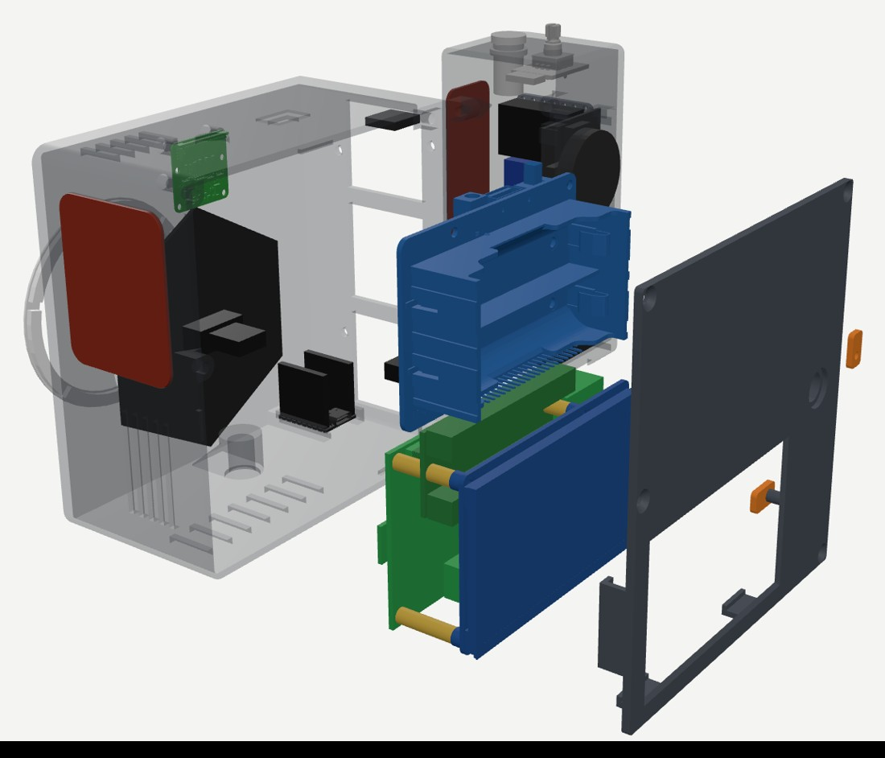

# Pi Multitool

Handgerät auf Basis eines Raspberry Pi 3 B mit Mikrofon-Array, Kamera und Display: akustische Kamera, Camcorder, Drohnen-, Bewegungs- und Geräuschüberwachung und BirdNET in einem Gerät.



## Modi

| Modus | Was er macht |
| --- | --- |
| Akustische Kamera | Farbige Schallkarte über dem Livebild, Foto und Video mit Karte |
| Maschinendiagnose | Schallkarte plus Spektrum der angepeilten Stelle, Mithören per Kopfhörer |
| Camcorder | Video mit Ton, Sprecher-Tracking, Zeitraffer, Start per Klatschen oder Pfiff |
| Drohnenerkennung | Alarm mit Blinken und Sirene, danach zeigt der LED-Ring die Richtung |
| Überwachungskamera | Aufnahme bei Bewegung mit Vorlauf |
| Überwachungsmikrofon | Meldet Geräusche mit Richtung |
| BirdNET | Vogelstimmen erkennen |

## Hardware

Raspberry Pi 3 B, Sipeed Mic Array 6+1, Raspberry Pi Camera Module 3, RP2040-Zero (als 8-Kanal-USB-Mikrofon), 3,5-Zoll-DSI-Display, UPS HAT, Sirene.

## Ordner

| Ordner | Inhalt |
| --- | --- |
| [`Dokumentation/`](Dokumentation) | Ausführliche Anleitung (Word), Löt- und Verdrahtungsanleitung |
| [`CAD/Gehaeuse_V2/`](CAD/Gehaeuse_V2) | Gehäuse als STEP und STL, Druckteile, Explosionszeichnung, parametrisches Skript |
| [`software/`](software) | Programm, Installation, Firmware für den RP2040-Zero, YAMNet-Modell |

## Schnellstart

Die ganze Anleitung steht in [`Dokumentation/Pi_Multitool_Dokumentation.docx`](Dokumentation/Pi_Multitool_Dokumentation.docx), die Kurzform in [`software/README.md`](software/README.md).

Ohne Hardware am PC ausprobieren (Python 3.10+):

```
cd software
pip install numpy scipy opencv-python-headless pillow pyyaml flask qrcode
python -m multitool --sim
```

Dann `http://localhost:8080` öffnen.

> Stand: Die Software ist vollständig geschrieben und in der Simulation getestet, aber noch nicht auf der echten Hardware gelaufen.

## Lizenz

Eigener Code, CAD-Dateien und Dokumentation: [MIT-Lizenz](LICENSE).

Fremde Bestandteile behalten ihre eigene Lizenz:

- `software/models/yamnet.tflite` und `yamnet_class_map.csv`: YAMNet von Google, Apache-2.0
- `software/firmware/*.uf2`: gebaut aus [microphone-array-library-for-pico](https://github.com/denisgav/microphone-array-library-for-pico), MIT
- `Dokumentation/AED6-6+1 Mikrofon-Array … AliExpress.pdf`: Produktseite des Herstellers, nur zur Information
